<div align="center">

  

  <br />

  <a href="https://git.io/typing-svg">
    
  </a>

  <p>
    <a href="https://github.com/Amaterasu106?tab=repositories">
      
    </a>
    <a href="https://smart-lms-smoky.vercel.app/">
      
    </a>
    
  </p>

</div>


### ⚡ Active Jutsu (Open-Source Projects)

| Project | Stack | Description |
| :--- | :--- | :--- |
| **FinTrack** | `React` `Vite` `Tailwind` `Express` `MongoDB` | Personal money ledger with numpad entry, trash recovery, UPI support wall, anonymous inbox & Admin Console |
| **NexusLMS** | `React` `Tailwind CSS` `Vercel` | Modular course platform with lesson tracking, timed quizzes & admin course management |
| **Wayland & UI Rice** | `CachyOS` `Hyprland` `Niri` `Quickshell` | Custom multi-compositor Linux configurations, QML widgets & interactive UI motion systems |


### 🛠️ Shinobi Arsenal

```text
Frontend   ──▶  React · Vite · Tailwind CSS · Framer Motion · Capacitor
Backend    ──▶  Node.js · Express · MongoDB Atlas · MySQL · Python
Workflow   ──▶  Git · GitHub · Vercel · CachyOS Linux · Fish Shell
<div align="center">
  
</div>
